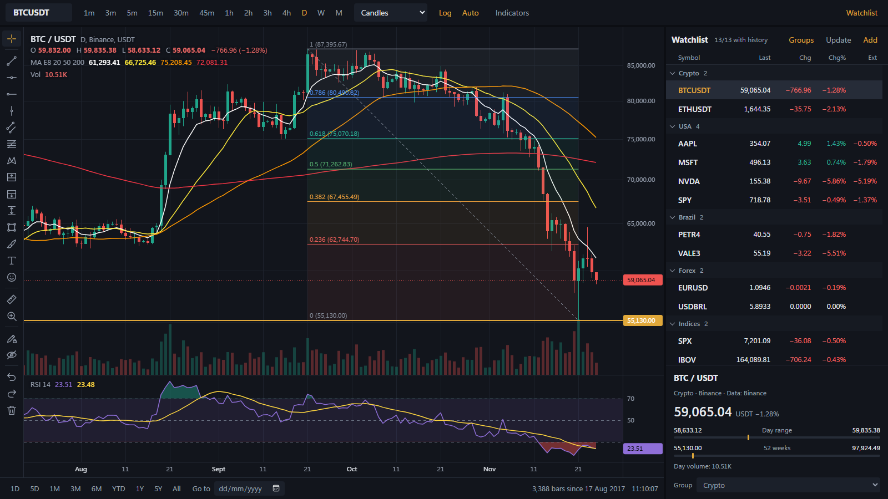

# Charts

Local-first charting for stocks, ETFs, indices, forex, futures and crypto on Windows. No account, no subscription, and no limit on symbols, indicators or drawings. Your watchlist, drawings and price history stay in one file on your computer.



- [Features](#features)
- [Install](#install)
- [Run](#run)
- [User guide](#user-guide)
- [Your data](#your-data)
- [Data sources and limits](#data-sources-and-limits)
- [Troubleshooting](#troubleshooting)
- [Development](#development)

## Features

- **Watchlist** with last price, change, change % and extended hours. Automatic groups (Crypto, USA, Brazil, Forex, Indices, Commodities), your own groups, color flags, and drag to reorder.
- **Search** across US stocks, B3 and other exchanges, ETFs, indices, forex, futures and crypto.
- **13 timeframes**, from 1 minute to 1 month, plus one-click ranges from 1 day to all history.
- **6 chart types:** candles, hollow candles, bars, line, area and Heikin Ashi. Log or linear scale.
- **Indicators:** four configurable moving averages (EMA 8, SMA 20, 50 and 200 by default), RSI 14 with its average, and volume.
- **Drawings** saved per symbol: trend line, horizontal and vertical lines, horizontal ray, parallel channel, Fibonacci retracement, XABCD, long and short positions with risk/reward, price range, rectangle, text and emoji. Undo and redo included.
- **Works offline** with everything already downloaded.
- **On the iPhone and the web**, if you publish your own private site. See the [web guide](docs/web.md).

## Install

You need **Windows 10 or 11 (64-bit)** and Microsoft Edge or Google Chrome. Edge ships with Windows. Node.js is bundled, so there is nothing else to install.

Download from the [Releases page](https://github.com/almeidaah/charts/releases).

### Option 1: setup.exe (recommended)

1. Download `setup.exe` and open it.
2. Choose the folder and click **Install**. Administrator rights are not needed.
3. Open **Charts** from the Start menu or the desktop.

`setup.exe` is not code-signed, so Windows may show a SmartScreen warning. If you trust the download, click **More info**, then **Run anyway**.

Silent install:

```powershell
setup.exe /quiet /dir="C:\Apps\Charts" /nodesktop
```

### Option 2: portable

1. Download `Charts-portable.zip` and extract it anywhere you can write to, such as your Documents folder.
2. Open `charts.exe` inside the `Charts` folder.

Keep `charts.exe` in its folder. To have an icon elsewhere, create a shortcut to it.

### Option 3: from source

You need [Node.js 24 or newer](https://nodejs.org). There are no packages to install.

```powershell
git clone https://github.com/almeidaah/charts.git
```

```powershell
cd charts
```

```powershell
npm start
```

You can also double-click `start.bat`.

### Update

Close Charts, then run the new `setup.exe` using the same folder, or extract the new zip over the old folder. Your `data` folder is not part of either package, so it is kept.

### Uninstall

Go to **Settings > Apps > Installed apps > Charts > Uninstall**. Your `data` folder is kept; delete it if you no longer want it. For the portable version, delete the folder.

## Run

| How you installed | How to open | How to close |
| --- | --- | --- |
| setup.exe or portable | `charts.exe` or the shortcut | Close the window |
| From source | `npm start` or `start.bat` | Close the terminal window |

`charts.exe` starts a small local server, opens a window, and stops the server when you close it. The server listens on `127.0.0.1:5180` and only accepts requests from your own computer.

On the first run Charts adds a small starter watchlist and downloads its daily history. This takes a few seconds.

## User guide

### Watchlist

- **Add a symbol:** start typing anywhere, or click **Add**. Use the exchange code or the name: `AAPL`, `PETR4`, `BTCUSDT`, `gold`. Press <kbd>Enter</kbd> to pick.
- **Remove:** hover the row and click **×**. The downloaded history and drawings are kept.
- **Reorder:** drag a row.
- **Flag:** click the left edge of a row to cycle through colors.
- **Groups:** click a group title to collapse it, or drag the title to reorder groups. Drop a row on another group to move it. To create a group, select a symbol and choose **New group…** under the watchlist. The **Groups** button turns grouping on and off.
- **Browse:** use <kbd>↑</kbd> and <kbd>↓</kbd> to go through the list.
- **Update** refreshes the daily history of every symbol.

### Chart

| To do this | Do this |
| --- | --- |
| Scroll | Drag, or <kbd>Shift</kbd> + mouse wheel |
| Zoom | Mouse wheel |
| Stretch prices | Drag the price axis. Double-click it to auto-fit |
| Stretch time | Drag the time axis. Double-click it to reset |
| Resize the RSI pane | Drag the line above it |
| Jump to a date | **Go to**, at the bottom |
| Change the range | **1D** to **All**, at the bottom |

Intraday times are shown in your computer's time zone. Daily and longer bars use the exchange date.

### Indicators

Hover an indicator name on the chart to hide it, open its settings or remove it. The **Indicators** button lists all of them, with lengths, types and colors. Settings apply to every symbol and are saved.

### Drawings

Pick a tool on the left, then click each point. Two-point tools also accept a drag. Click a drawing to select it, drag it to move it, or drag its handles to adjust it. The bar at the top changes color, thickness and style, and can lock, duplicate or delete it.

- **Fibonacci:** edit the levels in the bar, separated by spaces, such as `0 0.382 0.5 0.618 1`.
- **Long and short positions:** click the entry price, then drag the target and stop handles. The label shows the percentages and the risk/reward.
- **Text:** <kbd>Enter</kbd> confirms and <kbd>Shift</kbd> + <kbd>Enter</kbd> adds a line. Double-click to edit.
- **Keep drawing** leaves the tool active, and **Hide all drawings** hides them without deleting.

Drawings are tied to time and price, so they stay in place when you change the timeframe.

### Keyboard shortcuts

| Keys | Action |
| --- | --- |
| Any letter or number | Search for a symbol |
| <kbd>↑</kbd> <kbd>↓</kbd> | Previous or next symbol |
| <kbd>Alt</kbd> + <kbd>T</kbd> | Trend line |
| <kbd>Alt</kbd> + <kbd>H</kbd> | Horizontal line |
| <kbd>Alt</kbd> + <kbd>V</kbd> | Vertical line |
| <kbd>Alt</kbd> + <kbd>J</kbd> | Horizontal ray |
| <kbd>Alt</kbd> + <kbd>F</kbd> | Fibonacci retracement |
| <kbd>Shift</kbd> + drag | Measure |
| <kbd>Ctrl</kbd> + <kbd>Z</kbd> / <kbd>Ctrl</kbd> + <kbd>Y</kbd> | Undo / redo |
| <kbd>Ctrl</kbd> + <kbd>D</kbd> | Duplicate the selected drawing |
| <kbd>Delete</kbd> | Delete the selected drawing |
| <kbd>Esc</kbd> | Cancel or deselect |

## Your data

Everything is in the `data` folder next to the program:

| Version | Location |
| --- | --- |
| setup.exe | `%LOCALAPPDATA%\Programs\Charts\data` |
| Portable | `data`, next to `charts.exe` |
| From source | `data`, in the project folder |

- **Back up:** close Charts and copy the `data` folder.
- **Move to another computer:** copy the `data` folder there while Charts is closed.
- **Export and import:** **More > Export backup** saves your watchlist, groups, drawings and indicators in one file, without price history.
- **Share with the web version:** **More > Web sync** makes the desktop use the same watchlist, groups, drawings and indicators as your site. See the [web guide](docs/web.md#use-the-same-data-everywhere).
- **From portable to installed:** copy `setup.exe` into the portable folder and run it from there. On the first install it brings along the `data` folder next to it.

Charts sends requests only to Yahoo Finance and Binance, to search symbols and fetch prices. There is no telemetry.

## Data sources and limits

Prices come from public endpoints of Yahoo Finance and Binance. No key is needed.

| Source | Daily | 1 hour | 5 to 30 minutes | 1 minute |
| --- | --- | --- | --- | --- |
| Yahoo Finance | Full history | About 2 years | About 60 days | 7 days |
| Binance | Since listing | Last 100,000 bars | Last 100,000 bars | Last 100,000 bars |

What you download stays in your database, so intraday history keeps growing beyond these limits as you use the symbol.

- Binance quotes refresh every few seconds. Yahoo quotes refresh about every 15 seconds and may be delayed by the exchange. When a price moves, the digits that changed turn green or red for a moment.
- Prices are adjusted for splits but not for dividends.
- The Yahoo Finance endpoints are unofficial, and may change or limit requests at any time. Check each provider's terms before using their data for anything beyond personal use.

## Troubleshooting

| Problem | What to do |
| --- | --- |
| "Port 5180 is being used by another program" | Close the other program, or run from source on another port: `$env:PORT=5190; npm start` |
| "Node.js was not found" | You are running from source. Install Node.js 24 or newer |
| A symbol shows "error" | Hover the row to see why. The provider may be limiting requests; wait a few minutes |
| "The data source has nothing for this timeframe" | Recently listed or thinly traded symbols may have no intraday data. Try a longer timeframe |
| A symbol is missing from search | Use the exchange code. Only symbols on Yahoo Finance or Binance spot are available |
| The window is blank or outdated | Close Charts and open it again |

## Development

Charts has **no dependencies**. The server uses Node's built-in HTTP and SQLite modules, and the interface is plain JavaScript on a canvas.

```
server/     HTTP API, SQLite storage, and the Yahoo and Binance providers
public/     Interface: chart engine, drawings, indicators, watchlist
api/        Entry point of the web version
scripts/    Development helpers
launcher/   Windows launcher and installer (C#) and the build script
test/       Automated tests
```

Run the tests:

```powershell
npm test
```

Build `charts.exe`, `setup.exe` and `Charts-portable.zip` into `dist`. It needs only Windows and Node.js, because the C# compiler ships with Windows:

```powershell
powershell -ExecutionPolicy Bypass -File launcher\build.ps1
```

Environment variables: `PORT` (default `5180`) and `CHARTS_DB` (database path).

See the [roadmap](ROADMAP.md) for what is planned.

## License

[MIT](LICENSE). You can use, change and share it, as long as the copyright notice is kept. The license covers this code only, not the market data.

## Disclaimer

Charts is for information only and is not investment advice. Prices may be delayed, incomplete or wrong. This project is independent and is not affiliated with Yahoo, Binance or any exchange or charting platform. Bundled software is listed in [third-party notices](THIRD_PARTY_NOTICES.md).
